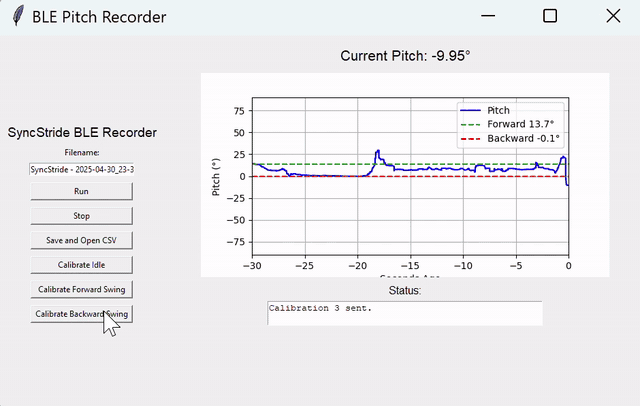
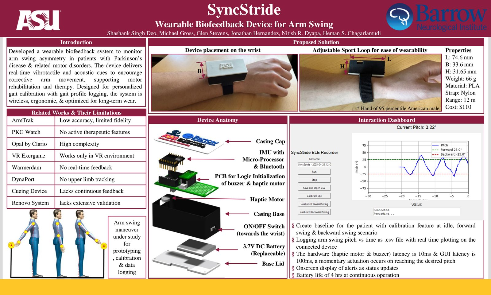
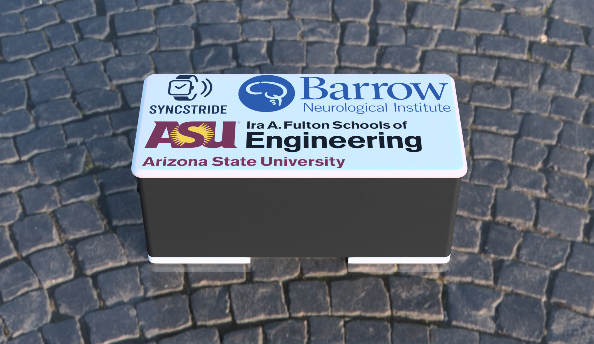
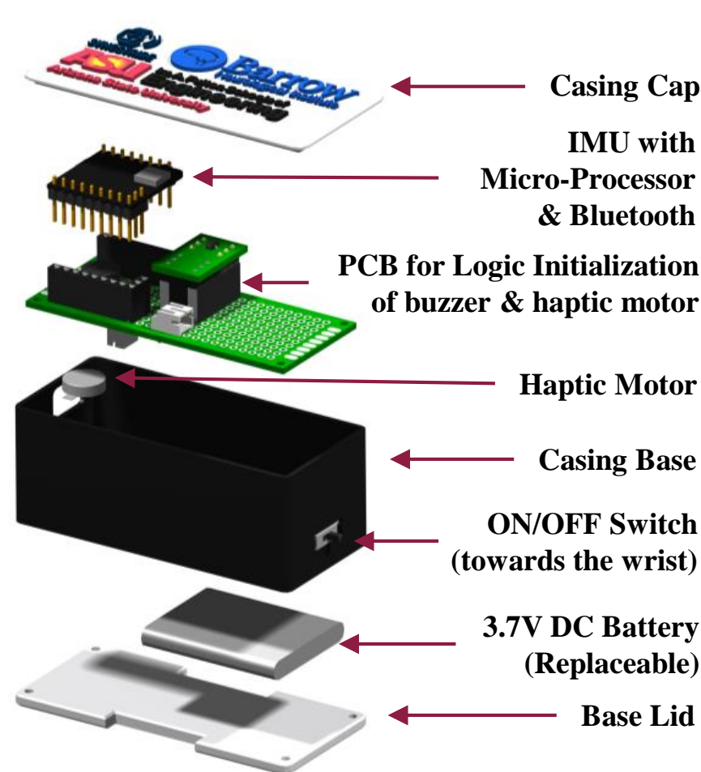
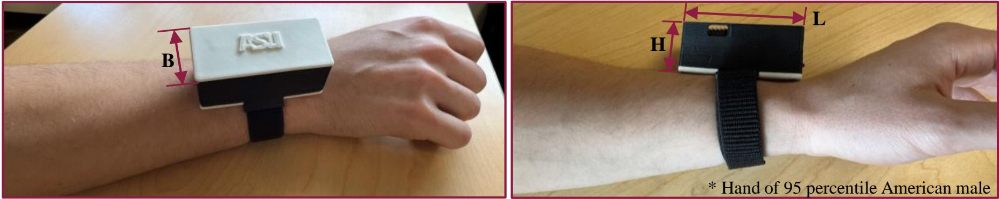
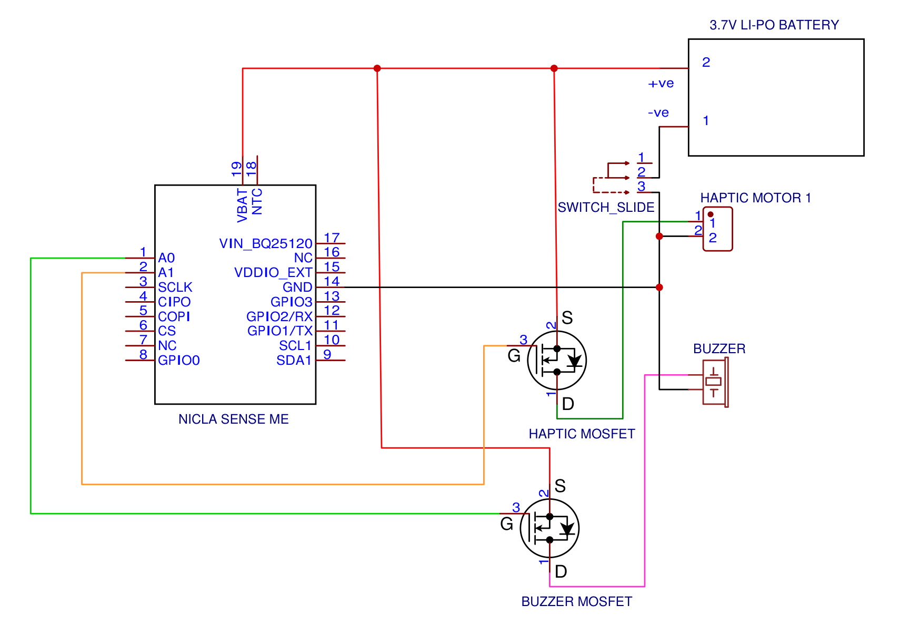
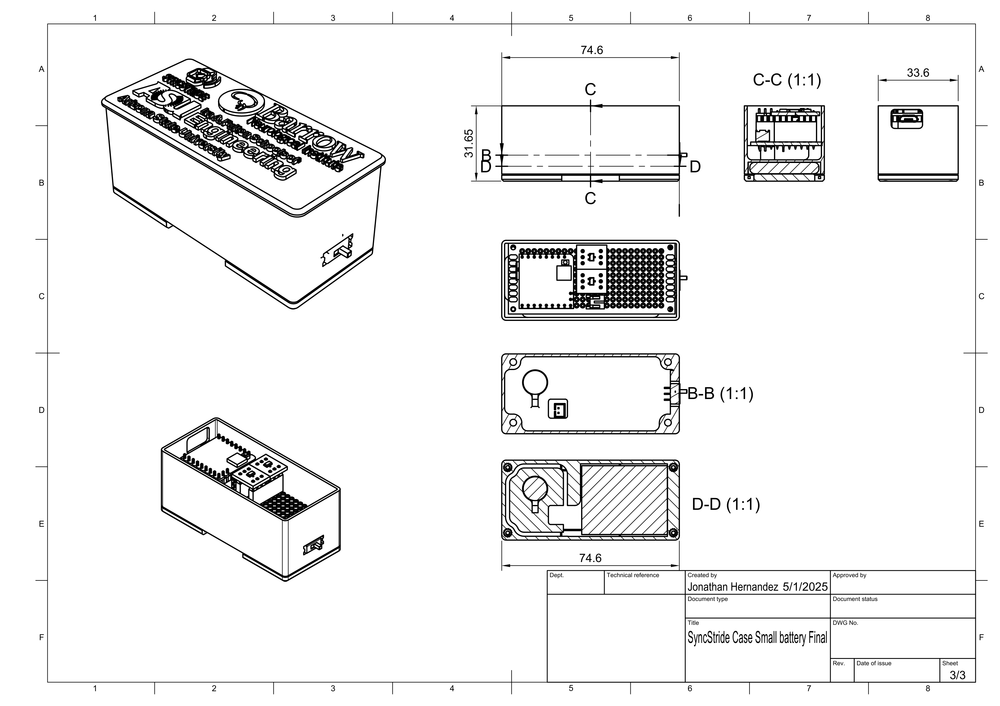
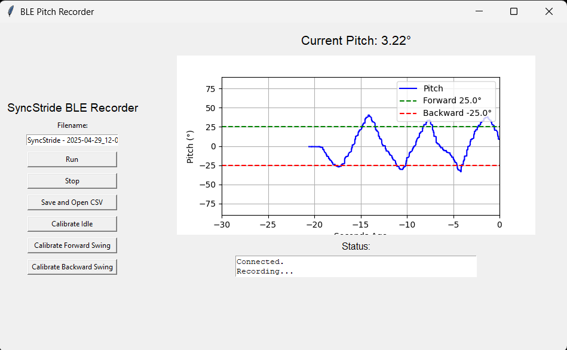

# SyncStride: Wearable Gait Biofeedback Device

[Web console](https://mgross21.github.io/syncstride-wearable/) · [Demo](https://mgross21.github.io/syncstride-wearable/?demo) · [Video](https://mgross21.github.io/syncstride-wearable/assets/demo.mp4)

## Overview

SyncStride is a wrist-mounted wearable designed for individuals with Parkinson’s Disease. It detects asymmetric arm swing in real-time and provides vibrotactile cues to encourage symmetrical gait patterns, helping reduce fall risk and improve mobility.

## Features

- Real-time IMU-based arm swing detection
- Vibrotactile and auditory feedback for movement correction
- BLE interface with Python GUI for live data and calibration
- Logs motion data to CSV for clinical analysis
- Ergonomic, lightweight, and adjustable for long-term use

## Hardware

- Nicla Sense ME microcontroller
- 6-axis IMU
- Vibration motor
- Rechargeable battery (>4h runtime)
- BLE module

| Property | Value |
| --- | --- |
| Dimensions (L × B × H) | 74.6 × 33.6 × 31.65 mm |
| Weight | 66 g |
| Casing | PLA |
| Strap | Nylon sport loop |
| Cost | $110 |

| Schematic | Case Drawing |
| --- | --- |
|  |  |

## GUI Alerts

- Device connected/disconnected
- Calibration (idle, forward, backward)
- Data saved to CSV
- Real-time pitch plotting

## Testing Highlights

- Feedback latency: 10 ms hardware, 100 ms GUI
- Detection accuracy: ±5° arm swing
- BLE range: ~12 m (~40 ft)
- Battery life: 4+ hrs
- Comfortable for extended wear

## Documents

- [Research poster](docs/poster.png)
- [Presentation slides](docs/presentation.pdf)
- [Circuit schematic](docs/hardware/schematic.pdf)
- [Case drawing](docs/hardware/case_drawing.pdf)

## Contributors

- Shashank Singh Deo
- [@MGross21](https://github.com/MGross21)
- Glen Stevens
- Jonathan Hernandez
- Nitish R. Dyapa
- Heman S. Chagarlamudi
